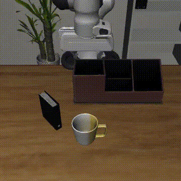

# π0.5 on LIBERO：跨框架复现诊断 + 6× V100 LoRA 微调

openpi 官方的 π0.5-LIBERO checkpoint 报告的平均成功率是 96.9%，但转换到 [LeRobot](https://github.com/huggingface/lerobot) 后，在 LeRobot 的评测流程里成功率只有 **0%**（社区报告见 [lerobot#2533](https://github.com/huggingface/lerobot/issues/2533)，本仓库也复现了）。本仓库定位到训练与评测之间的 **4 处不一致**，在**不改动任何权重**的前提下，只重建 checkpoint 的预处理 / 后处理管线，就把最难的 LIBERO-Long 从 **0% 恢复到 94%**（快速评测，100 个 episode），与 openpi 官方报告的 92.4% 持平，也高于 LeRobot 官方在 LeRobot 内重新微调的 checkpoint 在同一评测流程下的 85%。

在此基础上，从通用预训练权重 `lerobot/pi05_base` 出发，在 6 张 Tesla V100-32GB 上以 fp32 精度做 LoRA 微调（进行中）。

- 每处不一致都附有源码行号，以及 token 或数值层面的证据；修复逐项叠加，每加一项都在仿真里验证一次。
- 修复后的 checkpoint 可以直接交给 `lerobot-eval` 评测，不需要修改 LeRobot 源码。
- 框架：LeRobot 0.6.1；仿真：[LIBERO](https://libero-project.github.io/)，无头渲染用 OSMesa。

<p align="center">
  
  <br>
  <em>4 处修复后的 <code>pi05_libero_base</code>，LIBERO-Long 任务 5："pick up the book and place it in the back compartment of the caddy"（成功）。视频按仿真声明的 80 fps 编码，实际控制频率为 20 Hz，所以看起来是 4 倍速。</em>
</p>

## 诊断：`pi05_libero_base` 为什么在 LeRobot 里是 0%，又怎么回到 94%

`lerobot/pi05_libero_base` 是 openpi `pi05_libero` 的 PyTorch 转换版。它的权重没有问题，问题出在 LeRobot 给它配的 processor（输入 / 输出处理管线）和 openpi 训练时用的设置不一样：

| # | 不一致 | openpi 训练时 | LeRobot 默认 | 修复方式 |
|---|---|---|---|---|
| 1 | 归一化统计量 | 有 | checkpoint 里缺失，`lerobot-eval` 也不会补 | 补上统计量 |
| 2 | prompt 格式 | `<task>\n`（不含 state） | `Task: <task>, State: <8 个数>;\nAction: ` | 去掉拼接 state 的步骤 |
| 3 | 动作 chunk | horizon 10，每 5 步重新规划 | chunk 50，每 10 步重新规划 | 评测时覆盖参数 |
| 4 | 统计量来源 | `physical-intelligence/libero` | `HuggingFaceVLA/libero`，action 区间只有 openpi 的 46%–96% | 换成 openpi 发布的 `norm_stats.json` |

### 逐项修复的效果

先用最难的 Long 套件快速筛选（每个任务 10 个 episode）：

| checkpoint | 统计量 | prompt | chunk / 执行 | Long（快速¹） |
|---|---|---|---|---|
| `pi05_libero_base`（原样） | 无 | LeRobot | 50 / 10 | 0.0 |
| + #1 补统计量 | HF | LeRobot | 50 / 10 | 25.2² |
| + #2 openpi prompt | HF | openpi | 50 / 10 | 32.0 |
| + #3 openpi horizon | HF | openpi | 10 / 5 | 45.0 |
| + #4 openpi 统计量 | openpi | openpi | 10 / 5 | **94.0** |
| `pi05_libero_finetuned`（锚点³） | 自带 | LeRobot | 50 / 50 | 85.0 |
| openpi 官方报告 | openpi | openpi | 10 / 5 | 92.4 |

¹ 每个任务 10 个 episode，共 100 个。成功率在 50% 附近时 95% 置信区间约 ±10 个百分点，在 94% 附近约为 [87, 97]。² 这一行是完整评测（每个任务 50 个 episode）的结果。³ LeRobot 官方在 `pi05_libero` 基础上又全量微调了 6k 步，训练和评测都在 LeRobot 里完成，不存在上述不一致。用它来检验本仓库的评测流程本身是否可信。

完整评测（四个套件 × 10 个任务 × 50 个 episode）：

| checkpoint | 开环 L1⁴ | Spatial | Object | Goal | Long | 平均 |
|---|---|---|---|---|---|---|
| `pi05_libero_base`（原样） | TBD | TBD | TBD | TBD | TBD | TBD |
| + #1 补统计量 | TBD | 87.6 | 90.6 | 80.6 | 25.2 | 71.0 |
| + #1–#4 | TBD | TBD | TBD | TBD | TBD | TBD |
| openpi 官方报告 | — | 98.8 | 98.2 | 98.0 | 92.4 | 96.9 |

⁴ 不跑仿真：在数据集的 200 帧上，比较预测的首步动作与示教动作，取逐维 L1 误差的均值（真实尺度）。

**结论**
- **4 处修复叠加后，权重一点不改，Long 从 0% 恢复到 94.0%**，与 openpi 官方报告的 92.4% 在误差范围内持平。逐任务成功率为 100 / 100 / 100 / 100 / 100 / 90 / 100 / 100 / 50 / 100；修复前一直是 0% 的任务 6 现在是 100%，任务 8 也到了 50%。
- **影响最大的是统计量的来源（#4）**，单这一项就把 Long 从 45 提到 94。只补上 HF 数据集的统计量（#1）虽然能让模型动起来，但 action 区间偏窄，动作被系统性缩小，长时序任务大量失败。
- **统计量是否存在（#1）是前提**：没有统计量时是 0%，补上后四个套件平均 71.0%。
- **chunk 长度（#3）的影响比 prompt 格式（#2）大**：分别贡献 +13 和 +7 个点。#2 那一步还在快速评测的误差范围内。
- **差距的根源是训练和评测不一致，不是"是否全量微调"**。修复后的 `pi05_libero_base` 比在 LeRobot 内重新微调的锚点（85.0）还高。这也说明本仓库的评测条件（fp32 推理、OSMesa 渲染、关闭 torch.compile）可以复现官方水平；锚点偏低更可能是那个 checkpoint 本身的问题。

<!-- TODO: #1–#4 的完整四套件评测；剩余已知差异（影响应该已经很小）：图像 resize 顺序、bf16 → fp32 -->

### 各项不一致的细节

**#1 统计量缺失。** `policy_preprocessor.json` / `policy_postprocessor.json` 里 normalizer 的 `features` 为空，没有 stats 文件，`norm_map` 写的还是 `MEAN_STD`（pi0.5 用的是 `QUANTILES`）。LeRobot 的 normalizer 遇到没有统计量的键会原样返回。训练时 `lerobot-train` 会用数据集统计量覆盖，`lerobot-eval` 则不会。结果是两头都错：state 没有归一化就被离散成 256 档拼进 prompt（LIBERO 的 state 有一维原始值约为 3，超出 [-1, 1]，全部落进最后一档）；模型输出的 action 也没有反归一化，直接被当成真实动作执行。

**#2 prompt 格式。** openpi 训练 `pi05_libero` 时设置了 `discrete_state_input=False`（`training/config.py`），而且 π0.5 没有连续 state 的输入通道（`state_proj` 只在非 π0.5 分支里创建），所以这个模型**完全看不到 state**，只靠两路相机画面和任务文本做决策。LeRobot 的 π0.5 processor 则写死了要把 state 拼进 prompt。用 openpi 自带的 `paligemma_tokenizer.model` 核对过：

| prompt | 示例任务的 token 数 |
|---|---|
| openpi `pi05_libero` | 14 |
| LeRobot 默认 | 55 |
| LeRobot 去掉 state 拼接 + 末尾换行 | 14（与 openpi 逐个 token 一致） |

完整的源码证据见 [docs/state_input.md](docs/state_input.md)。仿真这一侧，LeRobot 和 openpi 是一致的：开局等待 10 步、图像旋转 180°、state 取 eef 位置 + axis-angle + 夹爪。

**#3 动作 chunk 长度。** openpi 用 `action_horizon=10` 训练，评测时每 5 步重新规划一次（`examples/libero/main.py` 中 `replan_steps=5`）。LeRobot 的配置却是 `chunk_size=50`、`n_action_steps=10`。π0.5 的所有动作 token 在同一次去噪里一起生成，彼此之间做双向注意力（`modeling_pi05.py` 中 `att_masks = [1] + [0] * (chunk_size - 1)`）。所以多出来的 40 个位置训练时从没出现过，还会通过注意力干扰前 10 步。

**#4 统计量来源。** openpi 训练时用的统计量，是从 `physical-intelligence/libero` 算出、随 checkpoint 一起发布的。和 `HuggingFaceVLA/libero` 算出来的相比，action 的 q01–q99 区间差别很大：

| action 维度 | x | y | z | rx | ry | rz | gripper |
|---|---|---|---|---|---|---|---|
| 区间比 HF / openpi | 0.74 | 0.81 | 0.84 | 0.62 | 0.73 | **0.46** | 0.96 |

区间偏窄，反归一化后执行的动作就会被系统性地缩小，rz 方向只剩一半左右。两边 QUANTILES 的公式相同（`2·(x−q01)/(q99−q01) − 1`），所以直接替换 q01 / q99 即可。

**修复方式**：权重和 `config.json` 原样保留，只用 [`scripts/attach_norm_stats.py`](scripts/attach_norm_stats.py) 另存一份 processor（构建方式与 `lerobot-train` 一致），#3 通过评测参数覆盖。

## LoRA 微调（进行中）

V100 不支持 bf16。4.1B 参数的模型在 fp32 下做全量微调，单卡放不下一份完整的模型和优化器状态（约 66 GB），所以只训练 LoRA。从 `lerobot/pi05_base` 出发，在 LeRobot 里训练、在 LeRobot 里评测，所以统计量、prompt 格式和 `chunk_size` 都随 checkpoint 一起保存，不会出现上面那些不一致。

LIBERO 成功率（%），每个套件 10 个任务 × 50 个 episode：

| 方法 | 起点 | 可训练参数 | Spatial | Object | Goal | Long | 平均 |
|---|---|---|---|---|---|---|---|
| openpi 全量微调（官方报告） | pi05_base | 100% | 98.8 | 98.2 | 98.0 | 92.4 | 96.9 |
| LeRobot 全量微调（官方报告） | pi05_libero | 100% | 97.0 | 99.0 | 98.0 | 96.0 | 97.5 |
| LeRobot 全量微调（本仓库评测） | pi05_libero | 100% | TBD | TBD | TBD | TBD | TBD |
| **LoRA r=32，default（本仓库）** | pi05_base | TBD | TBD | TBD | TBD | TBD | TBD |

### 消融：LoRA rank

LoRA 位置固定为 `default`。

| r | 可训练参数 | 显存 / 卡 | s / step | Spatial | Object | Goal | Long | 平均 |
|---|---|---|---|---|---|---|---|---|
| 8 | TBD | TBD | TBD | TBD | TBD | TBD | TBD | TBD |
| 32 | TBD | TBD | TBD | TBD | TBD | TBD | TBD | TBD |
| 64 | TBD | TBD | TBD | TBD | TBD | TBD | TBD | TBD |

### 消融：LoRA 作用位置

r = 32。

| 位置 | 覆盖的层 | LoRA 层数 | 可训练参数 | 显存 / 卡 | s / step | 平均 |
|---|---|---|---|---|---|---|
| `default` | action expert 的 q/v + 动作投影（LeRobot 默认） | 38 | TBD | TBD | TBD | TBD |
| `expert` | action expert 全部 attn + MLP + 动作/时间投影 | 130 | TBD | TBD | TBD | TBD |
| `all` | `expert` + PaliGemma 语言主干（视觉编码器冻结） | 256 | TBD | TBD | TBD | TBD |

`expert` 和 `all` 只差语言主干，这一对比用来回答"VLM 主干要不要一起适配"。

<!-- TODO: 结论（每张表 2–3 句），wandb 报告链接 -->

### 训练设置

| 项 | 值 |
|---|---|
| 硬件 | 6 × Tesla V100-SXM2-32GB，DDP |
| 精度 | fp32（`accelerate --mixed_precision=no`），gradient checkpointing |
| 起点 | `lerobot/pi05_base` |
| batch | 4 / 卡 × 6 = 24 |
| 步数 | TBD |
| 学习率 | 1e-4，warmup 1000 步，cosine 衰减 |
| LoRA | `lora_alpha = r` |
| 归一化 | state / action 用 LIBERO 数据集统计量做 QUANTILES 归一化 |
| 相机映射 | `image → base_0_rgb`，`image2 → left_wrist_0_rgb`，`right_wrist_0_rgb` 置空并 mask |

## 复现

运行环境（Python 3.12、PyTorch 2.7.1+cu118、LeRobot 0.6.1 + `[libero,peft,pi,training]`）由镜像提供；渲染用 OSMesa，环境问题见 [docs/troubleshooting.md](docs/troubleshooting.md)。

```bash
export HF_TOKEN=...          # google/paligemma-3b-pt-224 是 gated repo，需先在网页上申请访问
export WANDB_API_KEY=...

make check                   # 检查环境
make data                    # 下载 LIBERO 数据集（35 GB）
make eval                    # 评测锚点 checkpoint
```

**诊断**（文件都缓存好之后，可以 `export HF_HUB_OFFLINE=1` 离线运行）：

```bash
H='EXTRA_ARGS=--policy.chunk_size=10 --policy.n_action_steps=5'
make eval POLICY_PATH=lerobot/pi05_libero_base NAME=raw                                   # 原样
make norm-stats                                                                           # #1
make eval POLICY_PATH=outputs/ckpt/pi05_libero_base_with_stats NAME=fix1
make norm-stats OPENPI_PROMPT=1                                                           # #1 + #2
make eval POLICY_PATH=outputs/ckpt/pi05_libero_base_openpi_prompt NAME=fix12
make eval POLICY_PATH=outputs/ckpt/pi05_libero_base_openpi_prompt NAME=fix123 "$H"        # + #3
make norm-stats OPENPI_PROMPT=1 OPENPI_STATS=1                                            # + #4（需联网一次）
make eval POLICY_PATH=outputs/ckpt/pi05_libero_base_openpi_full NAME=fix1234 "$H"
```

只看 Long 套件做快速筛选：加上 `SUITES="libero_10:0-4 libero_10:5-9" N_EPISODES=10`。

**LoRA 训练**：

```bash
make train JOB_NAME=r32_default                         # 主实验
make train JOB_NAME=r8_default  LORA_R=8                # rank 消融
make train JOB_NAME=r64_default LORA_R=64
make train JOB_NAME=r32_expert  LORA_TARGETS=expert     # 位置消融
make train JOB_NAME=r32_all     LORA_TARGETS=all
make eval POLICY_PATH=outputs/<run>/checkpoints/last/pretrained_model NAME=<run>
```

快速冒烟测试：`make smoke`（6 卡 20 步，只用 10 条示教）、`make eval SUITES=libero_spatial TASK_IDS=[0] N_EPISODES=2`。全部参数见 `make help`。

## 仓库结构

```
├── Makefile                  # 入口：check / data / infer / smoke / train / eval / norm-stats
├── install.sh                # 初始化：建目录、HF 缓存路径、可选 editable lerobot
├── scripts/
│   ├── 1_check_setup.py      # 环境检查
│   ├── 2_inference.py        # 单步推理（pre/post-processor 管线）
│   ├── 3_train_lora.sh       # LoRA 训练（rank / 作用位置 / 起点可调）
│   ├── 4_eval_libero.sh      # LIBERO 评测，按套件 / 任务分片到多张卡
│   ├── summarize_eval.py     # 汇总 eval_info.json → markdown 表格（含逐任务成功率）
│   └── attach_norm_stats.py  # 重建 processor：补统计量 / openpi prompt / openpi 统计量 + 开环检查
└── docs/
    ├── state_input.md        # π0.5 的 state 输入：openpi 与 LeRobot 的差异（源码证据）
    ├── lerobot_pi05_guide.md # LeRobot 与 π0.5 的使用笔记
    └── troubleshooting.md    # 安装 / 渲染问题记录
```

## 参考

- Physical Intelligence, *π0.5: a Vision-Language-Action Model with Open-World Generalization*, [arXiv:2504.16054](https://arxiv.org/abs/2504.16054)
- [Physical-Intelligence/openpi](https://github.com/Physical-Intelligence/openpi)，[huggingface/lerobot](https://github.com/huggingface/lerobot)
- Liu et al., *LIBERO: Benchmarking Knowledge Transfer for Lifelong Robot Learning*, NeurIPS 2023
